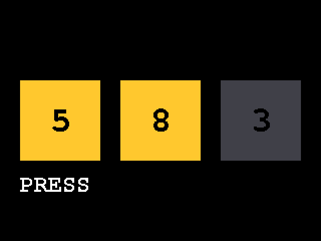
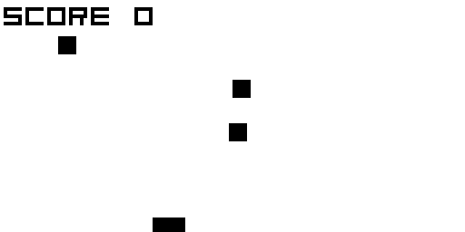
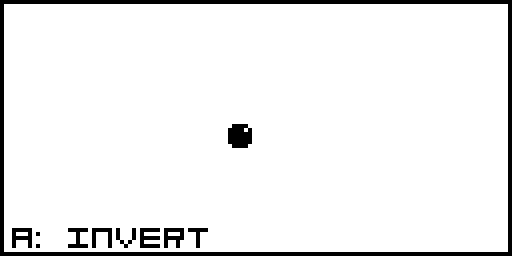

# Beautiful TinyGo

[English](README.md)

Claude に TinyGo の書き方を教える Claude Code プラグインです。マイコン向けに小さく、壊れにくく、Go らしいコードを書かせます。あわせて、液晶を使うプログラムを書き込み前にブラウザで確認させ、[koebiten](https://github.com/sago35/koebiten) のゲームを作らせ、Arduino、ESP-IDF、Moddable SDK、Arduboy のコードを移植させ、TinyGo のコードをレビューさせます。[BeautifulRust](https://github.com/morganlinton/BeautifulRust) を手本にしています。

TinyGo、ボード、`machine`、tinygo.org/x/drivers、koebiten、`.ino` ファイル、ESP-IDF のプロジェクト、Moddable の `main.js`、Arduboy のゲームが話題に出ると、スキルは自動で読み込まれます。

| スキル | 用途 |
|---|---|
| `tinygo-best-practices` | TinyGo のコード全般。メモリとアロケーション、標準ライブラリ、スケジューラと割り込み、`machine` パッケージ、ドライバ、液晶、バイナリサイズ、テスト。液晶を使うプログラムは WebAssembly プレビューでの確認が必須 |
| `koebiten-games` | 128×64 画面のミニゲーム。zero-kb02 などの TinyGo Keeb キーボード、gopher-board、Gopher Badge、PyBadge、Wio Terminal、ブラウザ |
| `tinygo-port` | Arduino のスケッチやライブラリ（M5Stack の Arduino コードを含む）、ESP-IDF のプログラム（FreeRTOS のタスク、IDF のドライバ、NVS、Wi-Fi）、Moddable SDK のプログラム（ECMA-419 の IO、センサークラス、Timer、Preference、Poco/Piu）、Arduboy のゲームを、同じ動作のまま TinyGo へ移植 |
| `tinygo-review` | 既存の TinyGo のコード、リポジトリ、プルリクエストのレビュー。重要度順（Must fix / Should fix / Consider / 良い点）の報告を作り、各指摘に `ファイル:行`、ルール一覧の ID と出典、ビルドやアロケーション確認の結果、修正コードを付ける。ファイルは変更しない |

**TinyGo 0.43** と **tinygo.org/x/drivers 0.36**（2026年10月）を前提に書いています。

## 液晶のプログラムは、まずプレビュー

液晶に描くプログラムは、必ず `-target=wasm` でもビルドします。スキルには次のものが入っています。

- canvas に描く Display
- キーボードで押せるボタン
- ブラウザ用のページ
- `tools/capture.cjs`：WebAssembly を Node で動かし、決めた時刻にキーを押して PNG を書き出すツール

Claude はスナップショットの画像を見てから結果を返します。人はページを開いて実際に遊べます。

```sh
tinygo build -o web/main.wasm -target=wasm -no-debug ./example
cp "$(tinygo env TINYGOROOT)/targets/wasm_exec.js" web/
node tools/capture.cjs web/main.wasm --at 300,1100 --keys "500:ArrowLeft:60,900:ArrowDown:60"
python3 -m http.server 8080 --directory web   # http://localhost:8080
```

| WebAssembly プレビュー（例、320×240） | koebiten テンプレート（128×64） | koebiten 上の Arduboy スプライト |
|---|---|---|
|  |  |  |

3枚とも、ブラウザを使わず `tools/capture.cjs` で出力したものです。

## Claude Code へのインストール

ターミナルから実行します（`OWNER` はこのリポジトリを置く GitHub アカウントに置き換えてください）。

```
claude plugin install beautiful-tinygo --marketplace OWNER/BeautifulTinyGo
```

Claude Code のセッション内からなら、次のとおりです。

```
/plugin marketplace add OWNER/BeautifulTinyGo
/plugin install beautiful-tinygo@beautiful-tinygo
```

インストールせずに1セッションだけ試す場合は、次のようにします。

```
git clone https://github.com/OWNER/BeautifulTinyGo
claude --plugin-dir ./BeautifulTinyGo
```

`/beautiful-tinygo:tinygo-best-practices` のように名前で呼び出すこともできます。

## claude.ai へのインストール

スキルごとに、スキルのフォルダを zip のルートにしてまとめます。

```
cd skills
zip -r ../tinygo-best-practices.zip tinygo-best-practices -x '*.DS_Store'
zip -r ../koebiten-games.zip koebiten-games -x '*.DS_Store'
zip -r ../tinygo-port.zip tinygo-port -x '*.DS_Store'
zip -r ../tinygo-review.zip tinygo-review -x '*.DS_Store'
```

**Customize > Skills** からアップロードします。ビルドとプレビューには TinyGo と Node が必要です。自分の PC で動く Claude Code なら使えますが、ホスト型のサンドボックスには入っていないことがあります。

## スキルが行うチェックに必要なもの

- TinyGo 0.43（Go 1.25〜1.27 で動作）。古い TinyGo でもほとんどの助言は当てはまります。バージョンで動作が変わる箇所は、スキル側で明記しています
- Node.js 18 以上（`tools/capture.cjs` 用。npm パッケージは不要）
- プレビューを配信する Python 3（またはほかの静的サーバー）と、テンプレート用の `make`

## 確認済みのこと

Linux 上の TinyGo 0.43.0（LLVM 19、Go 1.26）で確認しました。

- `assets/wasm-preview/example`
  - `-target=wasm` と `-target=waveshare-rp2040-zero` でビルドできる
  - `-target=m5stack` で型チェックが通る（使った LLVM に Xtensa バックエンドがないため、ESP32 のバイナリは生成していない）
  - `-print-allocs` で出るアロケーションは初期化部分だけ
- `tools/capture.cjs`
  - 上の例、koebiten テンプレート、koebiten 付属の `flappygopher` を動かし、上の画像を出力できる
- `assets/koebiten-template`
  - `tinygo test ./game` が通る（1フレームでアロケーションがないことを `testing.AllocsPerRun` で確認するテストを含む）
  - wasm、zero-kb02、gopher-board-spi、gopher-badge でビルドできる
- `assets/arduboy-compat`
  - `go test` と `tinygo test` が通る（Arduboy2 のビットマップ、スプライト、線、円の描画結果の一致と、アロケーションがないこと）
  - サンプルは wasm と zero-kb02 でビルドできる
- `tinygo-port/references/` の ESP-IDF と Moddable の移植例
  - `esp32c3-generic` でビルドできる（フラッシュ約 17 KB、ループ内のアロケーションなし）
  - `esp32s3-generic` と `esp32-generic` で型チェックが通る
  - tinygo.org/x/espradio を使う Wi-Fi のプログラム（接続して `net.Dial`）も ESP32-C3 向けにビルドできる
  - 移植元の ESP-IDF と Moddable のプログラムはビルドしていない（環境に IDF と Moddable のツールチェーンがないため）

実機ではまだ動かしていません。

## スキルのテスト

評価ケースは `evals/<スキル名>/<ケース名>/` にあります。形式は `claude plugin eval` が読む形（プロンプト、期待する結果、`graders/` に1ファイル1項目の判定基準）です。

評価ケースは、わざとスキルのフォルダの外に置いています。最初の評価で、スキルのフォルダを一覧表示したエージェントが隣の判定基準を見つけ、作業前に読んでしまったためです。

`claude plugin eval` は、プラグインのルートにある `evals/` を既定で読みます。各ケースを、プラグインありとなしの両方で実行します。

```
claude plugin eval . --allow-tools Write,Edit,Bash --scaffold --case whack-a-gopher --runs 1
```

実行には次のものが必要です。

- `PATH` 上の TinyGo と Node
- 評価ランナーのシェル用サンドボックス（Linux では `bubblewrap` と `socat`）

実際にモデルを動かすので料金がかかります。

## 評価結果

2026年10月、各ケースをスキルあり・なしで1回ずつ実行しました。

- 作業するモデル：Sonnet 5.5
- 採点：Haiku が判定基準ごとに3票で多数決
- 実行方法：公式の `claude plugin eval` が実行環境のサンドボックス内でビルドできなかったため、同じプロンプトと判定基準を `claude -p` で回しました

下の表は、ケースごとの最新の実行結果です。

| ケース | スキルあり | スキルなし |
|---|---|---|
| gauge-display-preview | 8/8 | 3/8 |
| hdc1080-driver | 9/9 | 6/9 |
| port-arduino-sketch | 9/9 | 8/9 |
| port-arduboy-game | 7/9 | 6/9 |
| refactor-big-go | 8/8 | 5/8 |
| whack-a-gopher | 7/8 | 6/8 |
| review-greenhouse-logger | 14/14 | 9/14 |
| **合計** | **62/65** | **43/65** |

差が大きかったのは、TinyGo が通常の Go と特に違う部分です。

- 液晶プログラムの WebAssembly プレビュー
- アロケーションしないドライバ
- 固まる原因を、協調スケジューラとヒープの増加で説明すること
- レビューで、ツールを実際に動かし、出典を引けるルールを示すこと

各側1回ずつの結果なので、1〜2項目の差はばらつきの範囲と考えてください。

## 更新手順

1. スキルを編集する
2. `.claude-plugin/plugin.json` の `version` を上げ、`CHANGELOG.md` に追記する
3. `claude plugin validate .` で確認する

利用者は `claude plugin update beautiful-tinygo` で更新できます。

## 出典とライセンス

出典ごとのライセンスは [README.md](README.md#sources-and-attribution) の表にまとめています。`references/` のダイジェストは、このプロジェクト用に要約して書き直したものです。元文書へのリンクを付けています。このリポジトリのスキル本文、ダイジェスト、テンプレート、ツール、画像は MIT ライセンスです。
