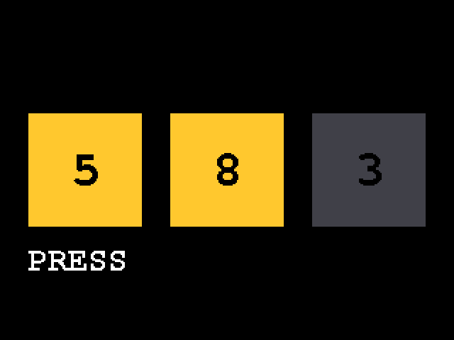
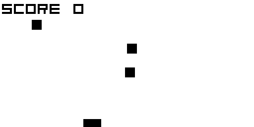
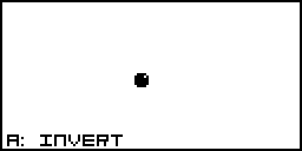

# Beautiful TinyGo

[日本語](README.ja.md)

A Claude Code plugin that teaches Claude to write small, robust, idiomatic
[TinyGo](https://tinygo.org/) for microcontrollers, to check display programs in a
browser before flashing them, to make [koebiten](https://github.com/sago35/koebiten)
games, to port Arduino, ESP-IDF, Moddable SDK, Arduboy and C game SDK (PicoLibSDK) code,
and to review TinyGo code. It is modelled on [BeautifulRust](https://github.com/morganlinton/BeautifulRust).

The skills load on their own whenever a task involves TinyGo, a board, `machine`,
tinygo.org/x/drivers, koebiten, an `.ino` file, an ESP-IDF project, a Moddable `main.js`,
an Arduboy game or a PicoLibSDK game.

| Skill | Use it for |
|---|---|
| `tinygo-best-practices` | Any TinyGo code: memory and allocation, the standard library, scheduling and interrupts, the `machine` package, drivers, displays, binary size, testing. Display programs must pass a WebAssembly preview. |
| `koebiten-games` | Mini games on 128×64 screens: zero-kb02 and other TinyGo Keeb keyboards, gopher-board, Gopher Badge, PyBadge, Wio Terminal, and the browser. |
| `tinygo-port` | Arduino sketches and libraries (including M5Stack Arduino code), ESP-IDF programs (FreeRTOS tasks, IDF drivers, NVS, Wi-Fi), Moddable SDK programs (ECMA-419 IO, sensor classes, Timer, Preference, Poco/Piu), Arduboy games and C games on console SDKs such as PicoLibSDK, moved to TinyGo with the same behavior. |
| `tinygo-review` | Reviews of existing TinyGo code, repositories and pull requests: a prioritized report (Must fix / Should fix / Consider / What's already good) where each finding cites `file:line`, a rule ID with its source from the rule catalog, evidence from builds and allocation checks, and a code fix. It does not change your files. |

Written against **TinyGo 0.43** and **tinygo.org/x/drivers 0.36** (October 2026).

## Display programs: preview first

Every program that draws on a display also builds for `-target=wasm`. The skill ships a
canvas display, keyboard buttons, a browser page, and `tools/capture.cjs`, which runs the
WebAssembly build in Node, presses keys on a schedule and writes PNG snapshots. Claude
looks at the snapshots before handing the code back; you open the page and play.

```sh
tinygo build -o web/main.wasm -target=wasm -no-debug ./example
cp "$(tinygo env TINYGOROOT)/targets/wasm_exec.js" web/
node tools/capture.cjs web/main.wasm --at 300,1100 --keys "500:ArrowLeft:60,900:ArrowDown:60"
python3 -m http.server 8080 --directory web   # http://localhost:8080
```

| WebAssembly preview (example, 320×240) | koebiten template (128×64) | Arduboy sprites on koebiten |
|---|---|---|
|  |  |  |

All three images were produced by `tools/capture.cjs` without a browser.

## Install in Claude Code

From a terminal:

```
claude plugin install beautiful-tinygo --marketplace sat0ken/BeautifulTinyGo
```

Or inside a Claude Code session:

```
/plugin marketplace add sat0ken/BeautifulTinyGo
/plugin install beautiful-tinygo@beautiful-tinygo
```

To try it for one session without installing:

```
git clone https://github.com/sat0ken/BeautifulTinyGo
claude --plugin-dir ./BeautifulTinyGo
```

The skills can also be called by name, for example `/beautiful-tinygo:tinygo-best-practices`.

## Install in claude.ai

claude.ai takes one zip per skill, with the skill folder as the zip root:

```
cd skills
zip -r ../tinygo-best-practices.zip tinygo-best-practices -x '*.DS_Store'
zip -r ../koebiten-games.zip koebiten-games -x '*.DS_Store'
zip -r ../tinygo-port.zip tinygo-port -x '*.DS_Store'
zip -r ../tinygo-review.zip tinygo-review -x '*.DS_Store'
```

Upload them under **Customize > Skills**. Building and previewing need TinyGo and Node,
which a Claude Code session on your own machine has and a hosted sandbox may not.

## Requirements for the checks the skills run

- TinyGo 0.43 (works with Go 1.25 to 1.27). Older TinyGo works for most of the advice;
  the skills say where behavior depends on the version.
- Node.js 18 or later for `tools/capture.cjs` (no npm packages needed).
- Python 3 (or any static file server) to serve the preview, and `make` for the templates.

## Layout

```
BeautifulTinyGo/
├── .claude-plugin/            plugin.json, marketplace.json
├── skills/
│   ├── tinygo-best-practices/
│   │   ├── SKILL.md
│   │   ├── references/        digests: driver design, memory and size, language and
│   │   │                      runtime, Go idioms, the WebAssembly preview
│   │   └── assets/wasm-preview/   preview package, web page, capture tool, example
│   ├── koebiten-games/
│   │   ├── SKILL.md
│   │   └── assets/koebiten-template/   a small game with tests and a Makefile
│   ├── tinygo-port/
│   │   ├── SKILL.md
│   │   ├── references/        arduino-to-tinygo, espidf-to-tinygo, moddable-to-tinygo,
│   │   │                      arduboy-to-koebiten, c-games-to-tinygo
│   │   └── assets/arduboy-compat/      arduboy.Canvas (Arduboy2 drawing in Go) + example
│   └── tinygo-review/
│       ├── SKILL.md
│       └── references/rules.md   the rule catalog (TG-, KB-, PORT- IDs with sources)
├── evals/                     eval cases, kept outside the skill folders
│   ├── tinygo-best-practices/ hdc1080-driver, gauge-display-preview, refactor-big-go
│   ├── koebiten-games/        whack-a-gopher
│   ├── tinygo-port/           port-arduino-sketch, port-arduboy-game
│   └── tinygo-review/         review-greenhouse-logger
├── assets/                    images for this README
├── CHANGELOG.md
└── LICENSE
```

## What has been verified

With TinyGo 0.43.0 (LLVM 19, Go 1.26) on Linux:

- `assets/wasm-preview/example` builds for `-target=wasm` and
  `-target=waveshare-rp2040-zero`, and type-checks for `-target=m5stack` (the LLVM used
  had no Xtensa backend, so no ESP32 binary was produced). `-print-allocs` shows
  allocations only in set-up code.
- `tools/capture.cjs` drives the example, the koebiten template and koebiten's own
  `flappygopher` and produces the snapshots above.
- `assets/koebiten-template` passes `tinygo test ./game` (including a
  `testing.AllocsPerRun` check that a frame allocates nothing) and builds for wasm,
  zero-kb02, gopher-board-spi and gopher-badge.
- `assets/arduboy-compat` passes `go test` and `tinygo test` (Arduboy2 bitmap, sprite,
  line and circle semantics, zero allocations), and its example builds for wasm and
  zero-kb02.
- The worked examples in `tinygo-port/references/espidf-to-tinygo.md` and
  `moddable-to-tinygo.md` build for `esp32c3-generic` (about 17 KB of flash, no
  allocation in the loop) and type-check for `esp32s3-generic` and `esp32-generic`. A
  Wi-Fi program using tinygo.org/x/espradio (connect, then `net.Dial`) builds for
  ESP32-C3. ESP-IDF and Moddable originals were not built (no IDF or Moddable toolchain
  in the environment).

Also checked:

- The constant-data figures in `tinygo-memory-and-size.md` (tables of slices copied into
  RAM, flat tables, strings and `//go:embed` data left in flash, a tinyfont font in RAM)
  were measured with the TinyGo 0.43.0 release build for `pico` and `esp32-generic`, with
  tinyfont 0.7.0.
- `tinygo-port/references/c-games-to-tinygo.md` summarizes
  [tinygo-esp32-cyd](https://github.com/sat0ken/tinygo-esp32-cyd), whose tests compare
  each port with the original C compiled on the host (TinyGo 0.44). Its author ran the
  games on hardware.

Apart from those games, nothing has been run on real hardware yet.

## Testing the skills

The eval cases are in `evals/<skill>/<case>/`, in the layout `claude plugin eval` reads
(prompt, expected outcome, one assertion per file under `graders/`). They sit outside the
skill folders on purpose: in a first run, an agent that listed a skill's folder found the
graders next to it and read them before working. `claude plugin eval` looks in `evals/`
at the plugin root by default and runs every case with and without the plugin:

```
claude plugin eval . --allow-tools Write,Edit,Bash --scaffold --case whack-a-gopher --runs 1
```

TinyGo and Node must be on `PATH`, and the runner needs its shell sandbox (on Linux,
`bubblewrap` and `socat`). These are real model runs and are billed.

## Eval results

One run per case and arm with Sonnet 5.5 (October 2026), graded by Haiku with three votes
per grader. The official `claude plugin eval` runner could not build inside its sandbox
in the environment used, so the same prompts and graders were run through `claude -p`.
Latest run per case:

| Case | With the skills | Without |
|---|---|---|
| gauge-display-preview | 8/8 | 3/8 |
| hdc1080-driver | 9/9 | 6/9 |
| port-arduino-sketch | 9/9 | 8/9 |
| port-arduboy-game | 7/9 | 6/9 |
| refactor-big-go | 8/8 | 5/8 |
| whack-a-gopher | 7/8 | 6/8 |
| review-greenhouse-logger | 14/14 | 9/14 |
| **Total** | **62/65** | **43/65** |

The largest gaps are where TinyGo differs most from ordinary Go: the WebAssembly preview
for display code, allocation-free drivers, explaining hangs by the cooperative
scheduler and heap growth, and, for reviews, running the tools and citing look-up-able
rules. One run per arm is noisy; treat differences of one or two
graders as within the noise.

## Updating

Edit the skills, bump `version` in `.claude-plugin/plugin.json`, add a line to
`CHANGELOG.md`, and check the manifest with `claude plugin validate .`. Installed users
update with `claude plugin update beautiful-tinygo`.

## Sources and attribution

The guidance is a synthesis. The digests in `references/` are paraphrased summaries
written for this project; they link to the originals, which have the full reasoning.

| Source | Author | License | Used for |
|---|---|---|---|
| [TinyGo documentation](https://tinygo.org/docs/) (Driver Design, Heap allocation, Optimizing binaries, Tips/Gotchas, Language features, Porting, Interrupts, volatile) and the 0.42/0.43 release notes | The TinyGo Authors | site content has no stated license | paraphrased digests with links |
| [tinygo.org/x/drivers](https://github.com/tinygo-org/drivers) | The TinyGo Authors | BSD-3-Clause | API facts; the templates import it |
| [Effective Go](https://go.dev/doc/effective_go), [Go Code Review Comments](https://go.dev/wiki/CodeReviewComments) | The Go Authors | CC BY 4.0 | paraphrased digest |
| [koebiten](https://github.com/sago35/koebiten) | sago35 | MIT | API facts; the templates import it and copy its web page at build time |
| [Arduboy2](https://github.com/MLXXXp/Arduboy2), [ArduboyTones](https://github.com/MLXXXp/ArduboyTones) | Scott Allen and contributors | BSD-3-Clause, MIT | API facts; `arduboy.Canvas` follows Arduboy2's drawing algorithms (see its `NOTICE`) |
| Adafruit-GFX (through Arduboy2) | Adafruit Industries | BSD-2-Clause | line and circle algorithms (see `NOTICE`) |
| [ESP-IDF](https://github.com/espressif/esp-idf) API reference | Espressif Systems | Apache-2.0 | API facts for the ESP-IDF mapping |
| [Moddable SDK](https://github.com/Moddable-OpenSource/moddable) documentation, modules and host providers | Moddable Tech | runtime LGPL-3.0, examples CC BY 4.0, docs as published | API facts for the Moddable mapping; the worked example is modelled on `examples/io/digital/button` (CC BY 4.0) |
| [tinygo.org/x/espradio](https://github.com/tinygo-org/espradio) | The TinyGo Authors | BSD-3-Clause | API facts for Wi-Fi and BLE on ESP chips |
| [PicoLibSDK](https://github.com/Panda381/PicoLibSDK) | Miroslav Nemecek | Unlicense (its own code; TINYGAME is GPLv3) | API facts and the original games of the worked example in `c-games-to-tinygo.md` |
| [tinygo-esp32-cyd](https://github.com/sat0ken/tinygo-esp32-cyd) | sat0ken | MIT | the worked example in `c-games-to-tinygo.md` and the palette frame buffer |
| [BeautifulRust](https://github.com/morganlinton/BeautifulRust) | Morgan Linton | MIT | the idea and the plugin/eval layout |

The skill text, digests, templates, tools and images in this repository are MIT licensed
(see [LICENSE](LICENSE)).
